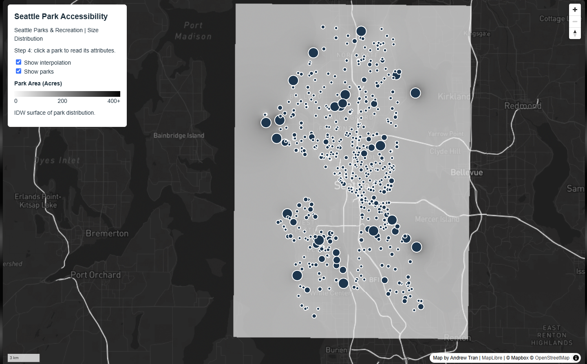
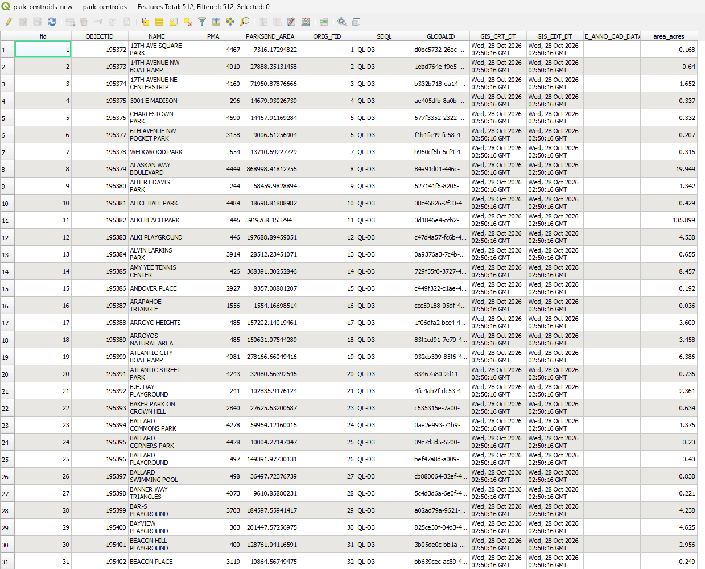

# Lab 3-2: Independent Map — Seattle Park Accessibility & Size Distribution

## Overview
My independent map focused on the spatial distribution and property size characteristics of parks managed by Seattle Parks and Recreation. It used a custom dark-themed Mapbox basemap, an interpolated IDW continuous surface representing park accessibility gradients, and an interactive vector point layer with detailed popups.

## Study Area & Topic
Topic: Seattle Park Accessibility & Property Size Distribution
Study Area: Seattle, Washington

## Data Sources
1. Data: 
   Dataset: Seattle Park Boundary (Centroids)
   Source: City of Seattle ArcGIS Online / Seattle GeoData
   Attributes Used: `Name`, `PARKSBND_AREA` (converted to acres), and `Property Management Area`
2. Basemap Tiles (`assets/mapbox_independent/`):
3. Thematic Interpolation Tiles (`assets/park-accessibility/`):
   Source: IDW interpolation surface from park centroid areas
   Export Format: Transparent background PNG tiles exported via QMetaTiles at zoom levels 8 through 12

## Methodology

### 1. Data 
-Downloaded the raw GeoJSON point dataset from Seattle GeoData.
-Imported the data into QGIS and reprojected the vector layer to EPSG:32610 (UTM Zone 10N)
-Used the Field Calculator to convert the raw square footage from (`PARKSBND_AREA`) into manageable decimal units (`area_acres`) using the expression:
  {PARKSBND_AREA}/{43560} to prevent errors during interpolation

### 2. IDW
-Ran the IDW Interpolation tool in the QGIS Processing Toolbox using the projected point layer and `area_acres` as the interpolation attribute.
-Used a distance coefficient of 2.0 and a 20 pixel cell size to generate a smooth, continuous surface raster (`data/park_idw.tif`)
-Used a Singleband Pseudocolor symbology with a gray color ramp

### 3. Tile Pyramid Export
-Set the QGIS project CRS back to EPSG:3857 (Web Mercator)
-Used the QMetaTiles plugin to export the styled raster surface into `lab3/assets/park-accessibility/` for zoom levels 8–12 using 100% background transparency

---

## Screenshots

  

  

